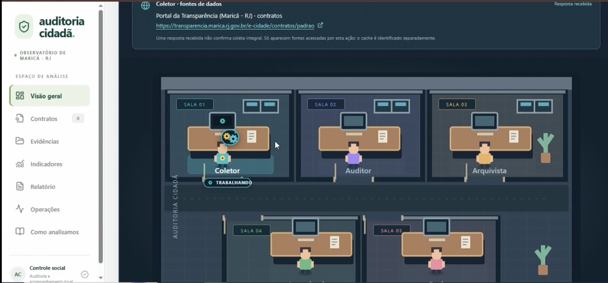

# 🏛️ Auditoria Cidadã Automatizada

> **Plataforma autônoma para auditoria cívica, fiscalização e inteligência de dados em contratações públicas municipais.**

<div align="center">
  
</div>

---

## 📌 Sobre o Projeto

A **Auditoria Cidadã Automatizada** é uma solução completa desenvolvida para fortalecer o controle social e a transparência pública. A ferramenta automatiza a coleta de dados de contratações de órgãos municipais (com foco inicial na Prefeitura de Maricá/RJ e abrangência nacional via PNCP), investiga possíveis inconformidades com **inteligência artificial multiagente**, valida evidências documentais por citação literal e disponibiliza um **painel visual interativo** em tempo real.

O sistema foi concebido com rigor analítico: nenhuma acusação ou suspeita é gerada sem suporte textual direto em documentos oficiais (diários oficiais, atas, editais e termos aditivos).

---

## 🚀 Principais Recursos

- **🤖 Equipe Multiagente Especializada (CrewAI + Gemini):**
  - **Agente Coletor:** Extração e captura automatizada de dados e requisições do portal da transparência via Playwright.
  - **Agente Auditor:** Avaliação estruturada de prazos, vigências, valores, objetos e cobertura contratual.
  - **Agentes Especialistas com Skills:** Análise aprofundada de Atas de Registro de Preços, compatibilidade de escopo e regularidade documental.
  - **Agente Arquivista:** Persistência relacional em PostgreSQL e emissão de relatórios e pareceres analíticos.
- **🛡️ Anti-Alucinação e Citações por Catálogo:** O modelo é impedido de formular conclusões sem embasamento. As evidências precisam corresponder a substrings exatas e auditáveis dos documentos oficiais.
- **📑 Leitura de Dossiês e OCR Local:** Download automático de PDFs oficiais, reconhecimento óptico de caracteres (OCR) local e extração de publicações do Diário Oficial (DOM/JOM).
- **🔍 RAG Local e Servidor MCP (Model Context Protocol):** Indexação e recuperação semântica local (BM25) sem necessidade de envio massivo de embeddings pagos.
- **📊 Conciliação Financeira:** Confronto entre empenhos, contratos e beneficiários, identificando conflitos de identidade e inconsistências de saldos.
- **🖥️ Painel Web Moderno (React + Vite):**
  - **Escritório dos Agentes:** Visualização com salas virtuais e telemetria animada em tempo real da atividade dos agentes.
  - **Visualização de Contratos:** Filtros avançados, consulta de alertas, detalhes de fornecedores e justificativas detalhadas.
  - **Central de Evidências:** Leitura de extratos, links do PNCP e busca textual direta.
  - **Indicadores de Gestão:** Análise com pandas da distribuição e concentração de valores por contratado.

---

## 📂 Estrutura do Repositório

```text
Auditoria_Cidada/
├── iniciar_painel.bat         # Script inicializador rápido (Interface + Servidor Local)
├── .env.example               # Modelo de variáveis de ambiente
├── requirements.txt           # Dependências Python do pipeline de auditoria
├── requirements-rag.txt       # Dependências complementares para OCR e busca local
├── src/                       # Código-fonte principal em Python
│   ├── agents/                # Definição dos agentes CrewAI (coletor, auditor, etc.)
│   ├── audit_skills/          # Guias de competências analíticas dos agentes
│   ├── tasks/                 # Tarefas estruturadas da Crew
│   ├── tools/                 # Ferramentas Playwright, web scraping e banco
│   ├── batch_pipeline.py      # Pipeline de auditoria em lotes com tolerância a falhas
│   ├── database.py            # Modelos SQLAlchemy e migração PostgreSQL
│   ├── documents.py           # Gestão de PDFs e extração via OCR
│   ├── gazette.py             # Varredura e indexação do Diário Oficial
│   ├── mcp_server.py          # Servidor MCP stdio para agentes
│   ├── pncp.py                # Integração com a API do PNCP
│   └── ui_jobs.py             # Executor de background tasks para a interface web
├── frontend/                  # Aplicação web React 19 + Vite
│   ├── src/                   # Componentes, estilos e lógicas do dashboard
│   ├── server/                # Middlewares Node.js para integração com o Python
│   └── package.json           # Dependências Node.js
└── imagens/                   # Imagens e documentação visual do projeto
    └── imagem01.jpg           # Screenshot demonstrativo do painel
```

---

## ⚙️ Pré-requisitos

- **Python:** 3.12 ou 3.13
- **Node.js:** versão LTS (v20+) e npm
- **PostgreSQL:** Banco local ou instância em nuvem (ex: Supabase)
- **Chave de API:** Google Gemini API Key

---

## 🏁 Instalação e Execução

### 1. Clonar o repositório e configurar o ambiente

```bash
git clone https://github.com/SEU-USUARIO/Auditoria_Cidada.git
cd Auditoria_Cidada
```

Crie o arquivo de configuração `.env` baseado no exemplo:

```bash
copy .env.example .env
```

Edite o `.env` e preencha suas configurações:
- `GEMINI_API_KEY`: sua chave obtida no [Google AI Studio](https://aistudio.google.com/)
- `DB_HOST`, `DB_NAME`, `DB_USER`, `DB_PASSWORD`: dados de conexão com o PostgreSQL

### 2. Configurar o ambiente Python

```powershell
python -m venv .venv
.\.venv\Scripts\activate
pip install -r requirements.txt
pip install -r requirements-rag.txt
python -m playwright install chromium
```

---

## 🎯 Inicialização Rápida

Para iniciar a aplicação com todos os serviços e abrir o painel web automaticamente no navegador, basta executar:

```powershell
.\iniciar_painel.bat
```

*(Ou simplesmente dê dois cliques no arquivo `iniciar_painel.bat` no Windows Explorer).*

O painel será iniciado e estará disponível em:
👉 **[http://127.0.0.1:5173](http://127.0.0.1:5173)**

A partir do painel você pode:
1. Iniciar ou retomar uma auditoria com acompanhamento visual dos agentes.
2. Ler e processar os documentos oficiais e diários.
3. Consultar o PNCP e conciliar notas de empenho financeiro.
4. Visualizar pareceres fundamentados e gerar relatórios em Markdown.

---

## 🧪 Execução dos Testes Automatizados

O projeto possui uma ampla suíte de testes de integridade, validação de regras de suporte e conciliação:

```powershell
.\.venv\Scripts\python.exe -m unittest discover -s tests -p "*.py"
```

---

## ⚖️ Responsabilidade e Transparência

As análises produzidas por esta plataforma constituem instrumentos de apoio ao controle cívico e à fiscalização participativa. Todas as classificações de auditoria apoiam-se exclusivamente em dados e publicações oficiais de acesso público, sujeitas à conferência documental humana.

---

## 📄 Licença

Distribuído sob a licença MIT. Consulte o arquivo de licença para mais detalhes.
